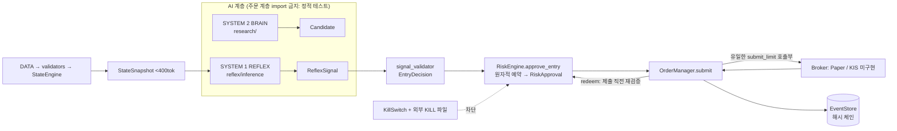
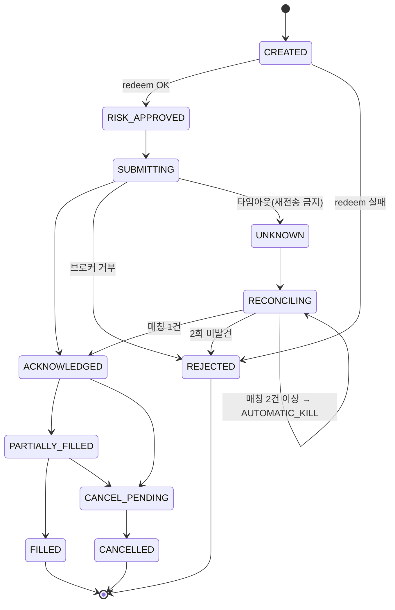

# 아키텍처 (초안 — GATE 2 대상)

## 1. 단일 주문 경로

- `submit_limit`를 호출하는 곳은 `execution/order_manager.py` 하나뿐이다(AST 테스트로 확인).
- 신호(`ReflexSignal`), 진입 판정(`EntryDecision`), 주문 승인(`RiskApproval`), 주문(`Order`)은 각각 다른 자료구조다.

## 2. 주문 상태 머신

## 3. 장애 복구
재시작 → `OMS.recovered=False`(신규 주문 거부) → 이벤트 저장소에서 주문 복원(제출 중이던 주문은 UNKNOWN 처리) → 브로커 주문 목록으로 2회 대사 → 포지션 대사 → 둘 다 성공해야 신규 주문을 허용한다 (`operations/recovery.py`, T14).

## 4. GATE 2에서 확정할 설계 (아직 미완)
- **프로세스 분리**: 주문 프로세스(실계좌 키를 가진 유일한 프로세스)와 리서치·모델 프로세스를 나누고, 그 사이에는 승인서만 오가는 IPC를 둔다. 현재는 단일 프로세스 내 논리 분리에 그친다.
- 영속 저장소: JSONL에서 SQLite/Postgres로 전환(트랜잭션과 동시 접근 필요 시)
- 현금 대사(수수료·세금 반영), 시각원(NTP) 연동, 알림 채널
