# SI-PMS 사용자 매뉴얼

SI 프로젝트 투입 인력·PC·IP/NAC·보안 서약을 한 곳에서 관리하고, 고객사 제출 대장을 HWP로 자동 출력하는 시스템입니다.

| 읽는 사람 | 볼 장 |
|---|---|
| **PMO(운영자)** | 1~4장, 7~9장 |
| **투입 인력** | 5장 |
| **고객사 보안담당(조회전용)** | 6장 |

> 이 매뉴얼의 화면은 가상 프로젝트 "OO공단 차세대 시스템 구축"을 실제로 운영해 보며 캡처했습니다.

---

## 1. 한눈에 보기

### 1.1 전체 흐름

```
 투입 인력                         시스템(자동)                          PMO
──────────────────────────────────────────────────────────────────────────────────
 현장 QR 스캔 → 정보·PC MAC 입력
 → 동의·서약·교육 확인 → 서명   ──▶  등록코드·MAC·소속사 검사
                                     승인 대기열에 자동 점검 결과 표시 ──▶ ① 승인 클릭
                                     빈 IP 자동 배정 + NAC 등록 요청 생성
                                     NAC 등록 파일(CSV)·신청서(HWP) 생성 ──▶ ② 파일 전달 후
                                                                            "완료" 클릭
 상태 화면에서 IP 확인         ◀──  IP·게이트웨이·DNS 공개
 (등록 전엔 IP를 알 수 없음)
                                     철수예정일 변경 시 만료일 변경 요청
 철수 시 상태 화면에서 철수서약 ──▶ 철수예정일 경과 → 자동 철수 진행
                                     NAC 해제 요청, 반입 장비 반출        ──▶ ③ 지급 PC 실물
                                     체크리스트 완료 → 철수 자동 완료        반납 기록
                                     매일 제출 패키지 ZIP, 매주 DB 백업
```

### 1.2 PMO가 직접 하는 일은 세 가지

1. **승인**: 대시보드의 승인 대기열에서 점검을 통과한 인원을 "일괄 승인"합니다.
2. **NAC 처리**: IP·NAC 화면에서 파일을 받아 NAC 담당자에게 전달하고, 처리가 끝나면 "완료 처리"를 누릅니다.
3. **지급 PC 실물 반납 기록**: 회사 PC를 돌려받으면 "반납"을 누릅니다.

나머지(IP 배정·회수, 신청서·대장 작성, 철수 전환·완료, 백업)는 시스템이 자동으로 합니다.

### 1.3 "등록하지 않으면 네트워크를 쓸 수 없다"는 원리

- 시스템은 **승인과 NAC 등록이 모두 끝나야** 투입 인력에게 IP를 알려 줍니다.
- 실제 차단은 고객사 NAC가 합니다. **NAC에 "미등록 MAC 차단" 정책이 켜져 있어야** 이 원리가 성립합니다.
- NAC 등록 파일에는 **만료일(철수예정일)**이 들어갑니다. NAC가 만료일을 지원하면 철수일에 NAC가 스스로 차단합니다.

---

## 2. 설치와 첫 실행

### 2.1 반입과 실행

반입할 파일은 실행파일 하나입니다(Windows용 `si-pms.exe`, Linux용 `si-pms`).

```
si-pms.exe -addr :8080 -data D:\si-pms\data
```

| 옵션 | 뜻 | 기본값 |
|---|---|---|
| `-addr` | 접속 받을 주소와 포트 | `:8080` |
| `-data` | 데이터 폴더(DB, 업로드 양식, 백업, 제출 패키지) | `data` |
| `-cert`, `-key` | HTTPS 인증서·개인키 파일(권장) | 없음(HTTP) |

처음 실행하면 콘솔에 **관리자 아이디 `admin`과 임시 비밀번호**가 한 번 표시됩니다. 꼭 적어 두세요.

> 서버 PC가 꺼지면 시스템도 멈춥니다. Windows라면 작업 스케줄러나 서비스 등록으로 부팅 시 자동 실행되게 해 두세요.

### 2.2 첫 로그인

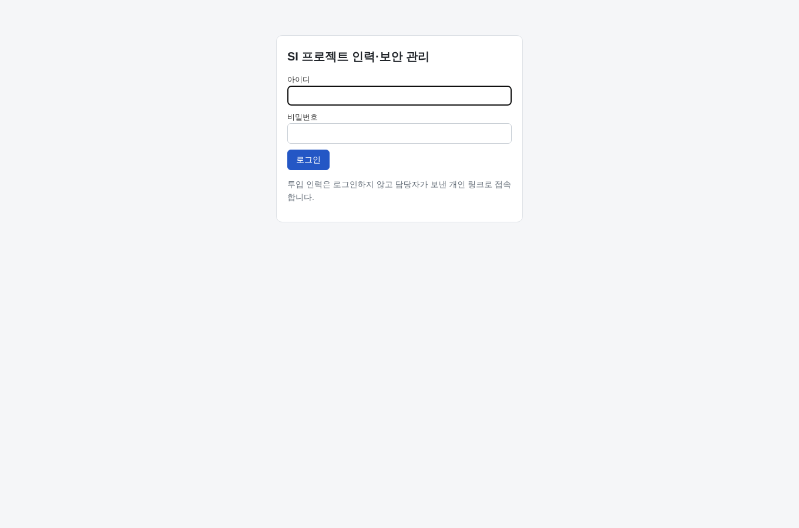

1. 브라우저에서 `http://서버주소:8080`으로 접속해 `admin`과 임시 비밀번호로 로그인합니다.
2. 비밀번호 변경 화면이 자동으로 뜹니다. **10자 이상, 영문 대·소문자/숫자/특수문자 중 3종 이상**으로 바꿉니다.
3. 오른쪽 위 이름을 눌러 **내 정보**에서 이름을 실명으로 바꿉니다. 이 이름이 대장의 **작성자·승인자**로 들어갑니다.

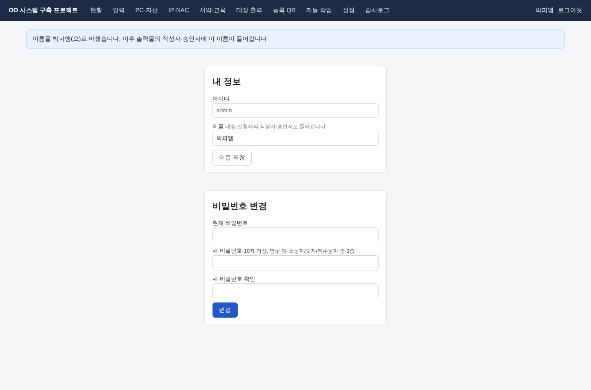

> 비밀번호를 5번 틀리면 10분간 잠깁니다.

---

## 3. 최초 설정 (프로젝트 시작 시 1회)

### 3.1 설정 화면

메뉴 **설정**에서 입력합니다. 저장할 때 모든 항목을 검사하며, **하나라도 틀리면 아무것도 저장되지 않고** 이유가 표시됩니다.

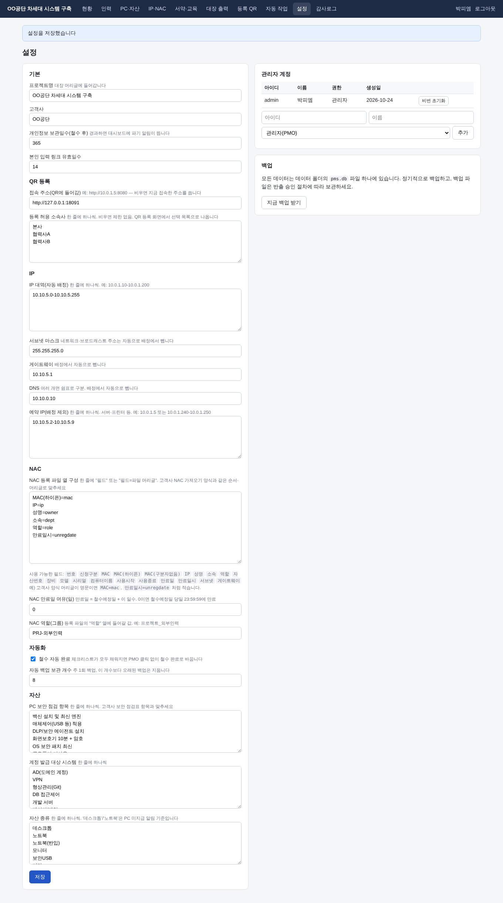

| 묶음 | 항목 | 입력 예 / 설명 |
|---|---|---|
| 기본 | 프로젝트명, 고객사 | 대장 머리글에 들어갑니다 |
| 기본 | 개인정보 보관일수 | `365`. 철수 후 이 기간이 지나면 파기 알림이 뜹니다 |
| QR 등록 | 접속 주소 | `http://10.10.5.5:8080`. QR 코드에 들어가는 주소이므로 **투입 인력 기기에서 열리는 주소**여야 합니다 |
| QR 등록 | 등록 허용 소속사 | 한 줄에 하나(`본사`, `협력사A` …). QR 화면에서 선택 목록으로 나옵니다 |
| IP | IP 대역 | `10.10.5.0-10.10.5.255`. 고객사 네트워크팀에서 받은 프로젝트 대역 |
| IP | 서브넷·게이트웨이·DNS | 투입 인력 화면에 그대로 안내됩니다 |
| IP | 예약 IP | 서버·프린터 등 사람에게 주면 안 되는 주소(`10.10.5.2-10.10.5.9`) |
| NAC | NAC 등록 파일 열 구성 | 고객사 NAC 가져오기 양식과 같은 순서로 한 줄에 하나. 머리글이 다르면 `필드=머리글` |
| NAC | 만료일 여유(일) | `0`이면 철수예정일 당일 23:59:59 만료 |
| NAC | 역할(그룹) | NAC에서 쓰는 그룹 이름(`PRJ-외부인력`) |
| 자동화 | 철수 자동 완료 | 켜면 체크리스트가 다 채워질 때 자동으로 철수 완료 |
| 자동화 | 자동 백업 보관 개수 | `8`(주 1회 → 약 2개월치) |
| 자산 | PC 보안 점검 항목 | 고객사 보안 점검표 항목과 똑같이 맞춥니다 |
| 자산 | 계정 발급 대상 시스템, 자산 종류 | 필요에 맞게 수정 |

**IP 자동 제외 규칙**: 대역 안에 있어도 네트워크 주소(.0), 브로드캐스트(.255), 게이트웨이, DNS, 예약 IP는 절대 배정하지 않습니다.

**NAC 파일 열 구성 예**(고객사 양식 머리글이 영문인 경우)

```
MAC(하이픈)=mac
IP=ip
성명=owner
소속=dept
역할=role
만료일시=unregdate
```

사용 가능한 필드는 설정 화면의 안내에 모두 나옵니다: 번호, 신청구분, MAC, MAC(하이픈), MAC(구분자없음), IP, 성명, 소속, 역할, 자산번호, 장비, 모델, 시리얼, 컴퓨터이름, 사용시작, 사용종료, 만료일, 만료일시, 서브넷, 게이트웨이.

> **NAC 담당자에게 꼭 확인할 것**: ① 가져오기 파일 양식(열 순서·머리글·MAC 표기) ② 등록 만료일 지원 여부 ③ 미등록 MAC 차단 정책 사용 여부

### 3.2 서약·동의·교육 문서

메뉴 **서약·교육**. 기본 문서 4종이 초안으로 들어 있습니다. **고객사 문구로 반드시 교체**하세요.

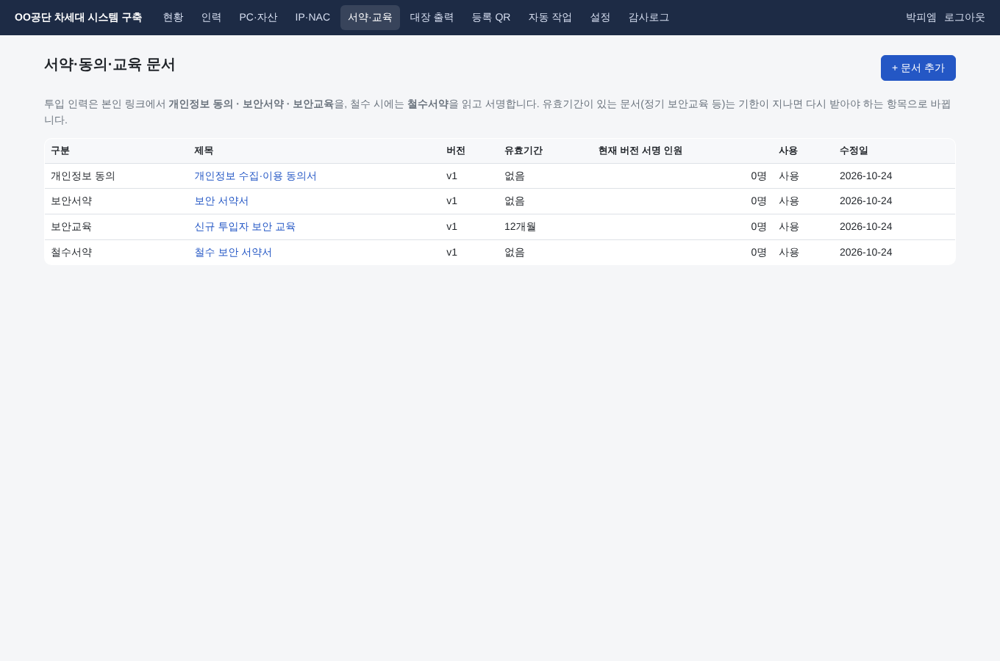

| 구분 | 언제 받나 | 비고 |
|---|---|---|
| 개인정보 동의 | QR 등록 시 | |
| 보안서약 | QR 등록 시 | |
| 보안교육 | QR 등록 시 | 유효기간(예: 12개월)을 두면 만료 30일 전 알림, 만료 시 재이행 필요 |
| 철수서약 | 철수 시 | 투입 인력의 상태 화면에 자동으로 나타남 |

- 문구만 고칠 때는 그냥 저장합니다(기존 서명 유효).
- 내용이 바뀌어 **전원이 다시 서명해야 하면** "전원 재서명 필요"에 체크하고 저장합니다. 버전이 올라가고, 모든 인원이 미이행 상태가 됩니다.
- 집합 교육을 했다면 문서 상세 화면에서 참석자를 체크하고 **"선택 인원 일괄 기록"**을 누릅니다.

### 3.3 회사 지급 PC 등록

메뉴 **PC·자산 → 자산 등록**. 여러 대면 엑셀로 만들어 한 번에 올립니다.

1. 엑셀에 `자산번호,종류,모델,시리얼,호스트명,IP,MAC,위치,비고` 순서로 작성합니다.
2. **파일 → 다른 이름으로 저장 → CSV UTF-8**로 저장합니다.
3. "엑셀(CSV)로 한꺼번에 등록"에서 업로드합니다.

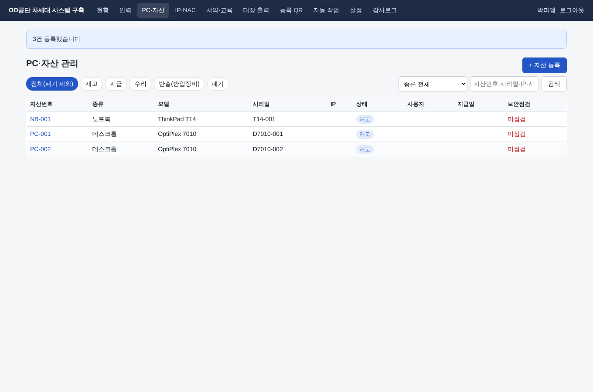

- **NAC 대상 PC는 MAC을 반드시 입력**하세요. MAC이 없으면 IP 배정과 NAC 요청이 만들어지지 않습니다.
- MAC은 `00-50-56-AA-00-01`, `0050.56AA.0001` 등 어떤 표기로 넣어도 `00:50:56:AA:00:01`로 맞춰지고, 다른 장비와 겹치면 거절됩니다.

### 3.4 QR 포스터 인쇄

메뉴 **등록 QR → 인쇄**. 출입구·자리·회의실에 붙입니다.

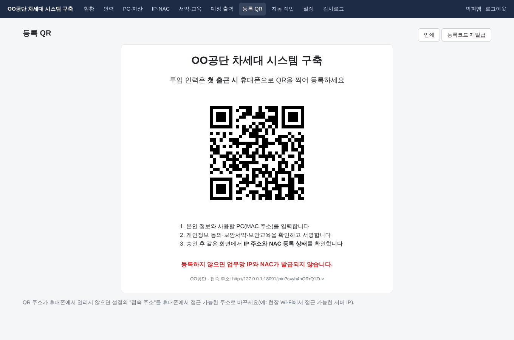

- QR이 외부로 유출된 것 같으면 **"등록코드 재발급"**을 누르세요. 이전 QR은 즉시 쓸 수 없게 되므로 새 QR을 다시 붙여야 합니다.
- **휴대폰이 이 서버에 접속되는지 먼저 시험해 보세요.** 폐쇄망 서버는 보통 LTE 휴대폰에서 열리지 않습니다. 해결 방법은 8장 "QR이 휴대폰에서 안 열려요"를 보세요.

### 3.5 고객사 보안담당 계정(선택)

**설정 → 관리자 계정**에서 권한을 **조회전용**으로 추가하면, 고객사 보안담당이 직접 현황을 확인하고 대장을 내려받을 수 있습니다. 임시 비밀번호는 화면에 한 번 표시됩니다.

---

## 4. 일상 업무 (PMO)

### 4.1 매일 아침: 대시보드 확인

메뉴 **현황**. "지금 챙겨야 할 일"에 처리할 일만 모아 보여 줍니다. 항목을 누르면 해당 화면으로 갑니다.

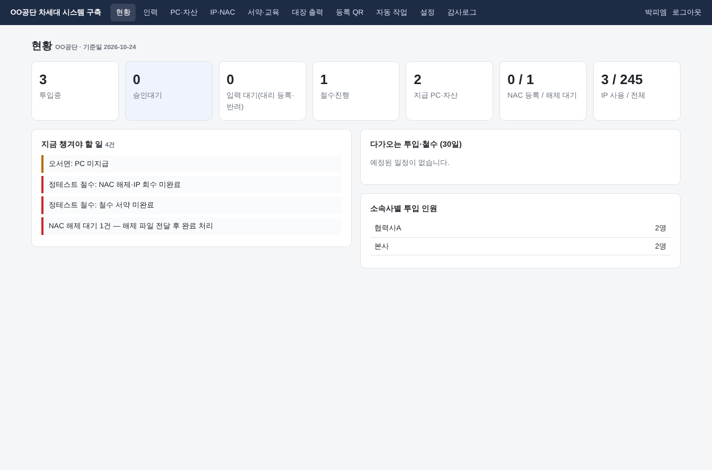

| 알림 | 할 일 |
|---|---|
| 승인 필요 | 4.2 승인 |
| NAC 등록·만료일 변경·해제 대기 | 4.4 NAC 처리 |
| 서약·교육 미이행/만료 임박 | 상태 화면 재방문 안내 또는 서면 기록(4.11) |
| PC 미지급 | 4.3 지급 PC 배정 |
| 보안 점검 기록 없음/부적합/30일 경과 | 4.5 보안 점검 |
| 철수예정일 14일 이내 | 연장이면 철수예정일 수정(4.7), 아니면 그대로 두면 자동 철수 |
| 철수 체크리스트 미완료 | 4.8 철수 |
| 개인정보 보관기간 경과 | 4.12 파기 |
| 자동 작업 실패 | 7.1 자동 작업 |

### 4.2 승인

대시보드 상단 **승인 대기**에 자동 점검 결과가 표시됩니다.

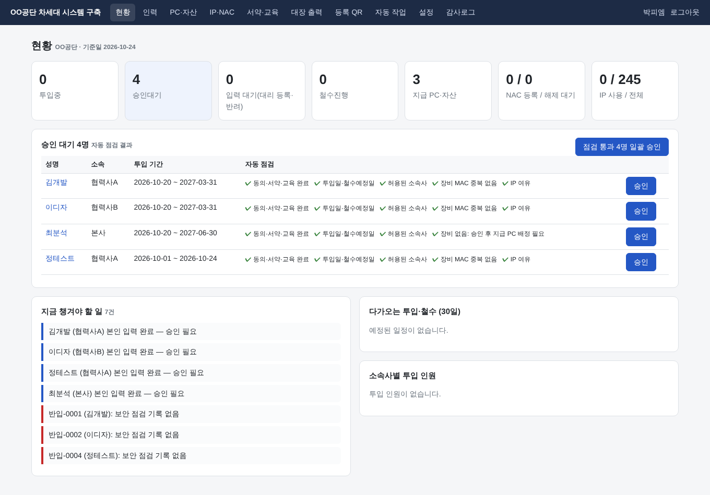

| 점검 항목 | 실패하면 |
|---|---|
| 동의·서약·교육 완료 | 본인이 다시 제출해야 함 |
| 투입일·철수예정일 / 철수예정일이 지나지 않음 | 인력 상세에서 날짜 수정 |
| 허용된 소속사 | 설정의 허용 소속사 확인 |
| 장비 MAC 중복 없음 | 자산 화면에서 중복 장비 확인 |
| IP 여유 | 설정에서 IP 대역 추가 |

- **"점검 통과 N명 일괄 승인"**을 누르면 한 번에 승인됩니다. 승인과 동시에 MAC이 있는 장비마다 **빈 IP가 배정**되고 **NAC 등록 요청**이 만들어집니다.
- 내용이 이상하면 인력 상세 화면에서 **반려**(사유 입력)합니다. 본인 상태 화면에서 다시 제출할 수 있습니다.

### 4.3 지급 PC 배정

QR 등록 때 "지급 PC"를 고른 인원은 승인 후 PC를 배정합니다. **인력 상세 → 지급 자산 → 재고에서 선택 → 지급**을 누릅니다.

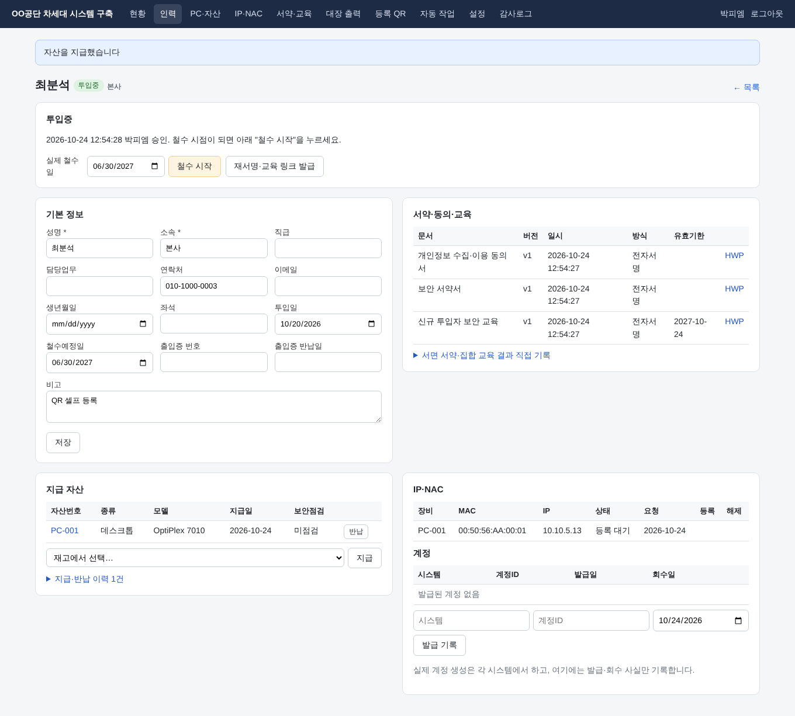

투입중인 인원에게 지급하면 그 PC의 IP 배정과 NAC 등록 요청이 바로 만들어집니다.

### 4.4 NAC 처리

메뉴 **IP·NAC**. 대기 건이 세 칸으로 나뉩니다.

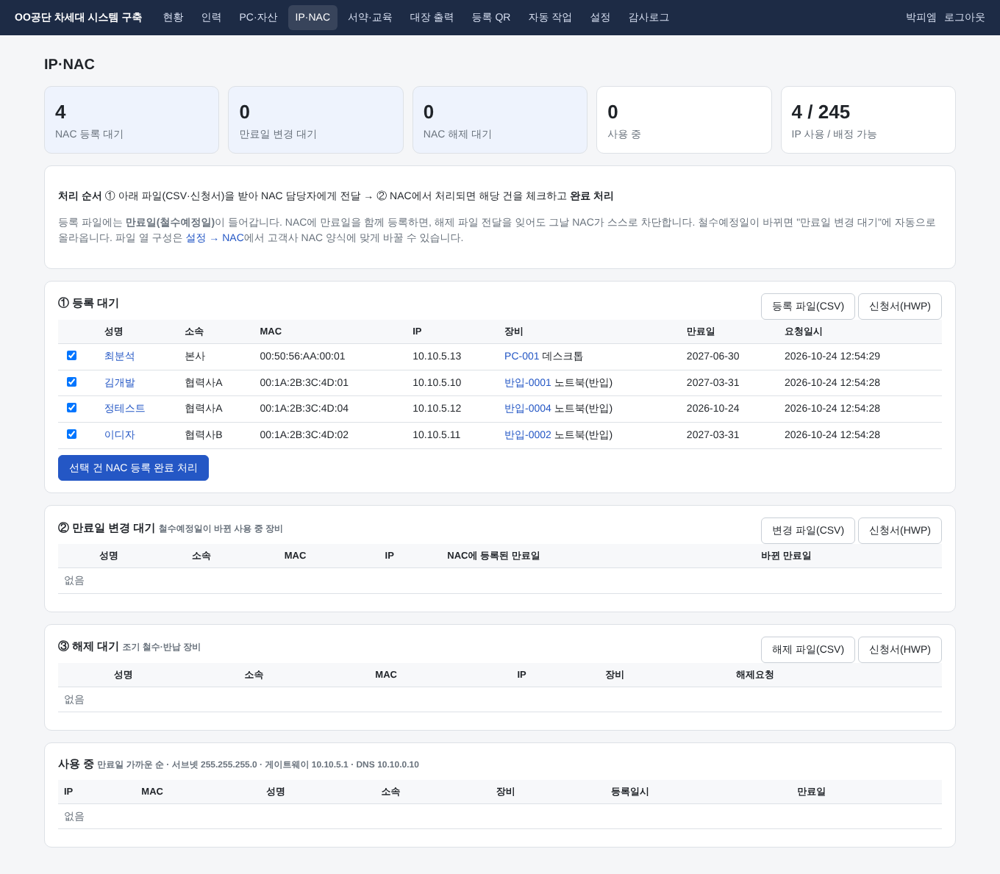

| 칸 | 언제 생기나 | 할 일 |
|---|---|---|
| ① 등록 대기 | 승인, 투입중 인원에게 PC 지급 | **등록 파일(CSV)**·**신청서(HWP)**를 받아 NAC 담당에게 전달 → 처리되면 체크 후 **완료 처리** |
| ② 만료일 변경 대기 | 철수예정일 변경(연장·단축) | 변경 파일 전달 → 완료 처리. **처리하지 않으면 예전 만료일에 네트워크가 끊깁니다** |
| ③ 해제 대기 | 철수 시작, PC 반납 | 해제 파일 전달 → 완료 처리. **IP가 회수되어** 다음 사람에게 배정됩니다 |

- "사용 중" 목록에 **"NAC 미반영"** 표시가 있으면 ② 처리가 아직 안 된 것입니다.
- 완료 처리는 실제로 NAC에 반영된 뒤에 누르세요. 누르는 순간 투입 인력 화면에 IP가 공개됩니다.

### 4.5 PC 보안 점검

**PC·자산 → 자산 선택 → 보안 점검**. 항목을 확인하며 체크하고 **"점검 결과 기록"**을 누릅니다. 하나라도 빠지면 "부적합"으로 기록되고 대시보드에 알림이 뜹니다.

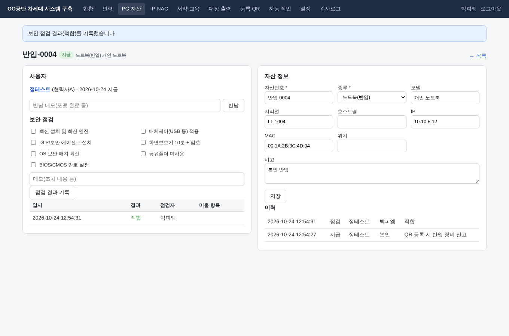

반입 노트북도 점검 대상입니다. 30일이 지나면 재점검 알림이 뜹니다.

### 4.6 계정 발급·회수 기록

**인력 상세 → 계정**. VPN·형상관리 등 계정을 각 시스템에서 만든 뒤 **시스템·계정ID를 기록**합니다. 철수 시 각 시스템에서 지운 뒤 **"회수"**를 누릅니다(철수 체크리스트 항목).

### 4.7 계약 연장·단축

**인력 상세 → 기본 정보 → 철수예정일**을 고치고 저장합니다. 등록된 장비가 있으면 **IP·NAC의 "② 만료일 변경 대기"**에 자동으로 올라오니, 변경 파일을 NAC 담당에게 전달하고 완료 처리합니다.

### 4.8 철수

**자동 철수**: 철수예정일이 지나면 다음 날 자동으로 "철수진행"으로 바뀌고, 반입 노트북은 반출 처리되며, NAC 해제 요청이 만들어집니다.

**조기 철수**: 인력 상세에서 실제 철수일을 넣고 **"철수 시작"**을 누릅니다.

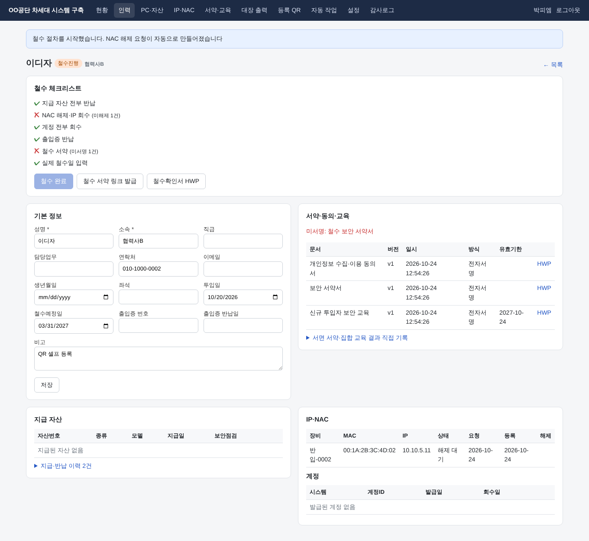

| 체크리스트 | 채우는 방법 |
|---|---|
| 지급 자산 전부 반납 | 회사 PC를 받고 "반납"(반입 노트북은 자동) |
| NAC 해제·IP 회수 | IP·NAC ③ 해제 완료 처리 |
| 계정 전부 회수 | 계정 "회수" |
| 출입증 반납 | "출입증 반납 확인"(출입증 번호를 입력한 경우만) |
| 철수 서약 | 본인이 상태 화면에서 서명. 이미 떠났다면 종이로 받고 서면 기록 |
| 실제 철수일 입력 | 철수 시작 시 자동 |

**모두 채워지면 자동으로 "철수완료"가 됩니다**(설정에서 끄면 직접 "철수 완료"를 눌러야 함). 고객사 제출용 **철수확인서(HWP)**는 인력 상세에서 받습니다.

### 4.9 대장 출력과 제출 패키지

메뉴 **대장 출력**.

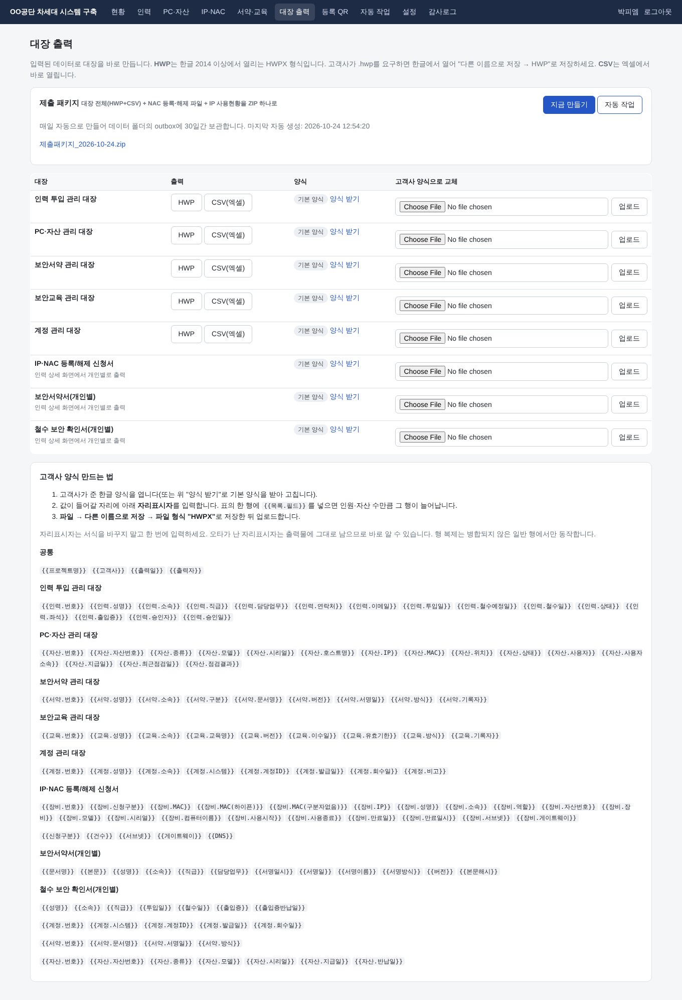

| 출력물 | 위치 |
|---|---|
| 인력 투입 / PC·자산 / 보안서약 / 보안교육 / 계정 관리 대장 | 대장 출력 → HWP 또는 CSV(엑셀) |
| IP·NAC 등록·변경·해제 신청서 | IP·NAC 화면 |
| 보안서약서(개인별) | 인력 상세 → 서약 목록의 "HWP" |
| 철수 보안 확인서(개인별) | 인력 상세 → "철수확인서 HWP" |
| **제출 패키지(ZIP)** | 대장 출력 → "지금 만들기", 또는 매일 자동 생성분 |

- HWP는 한글 2014 이상에서 열리는 **HWPX 형식**입니다. 고객사가 .hwp를 요구하면 한글에서 열어 "다른 이름으로 저장 → HWP"로 저장하세요.
- **고객사 양식으로 바꾸기**: "양식 받기"로 기본 양식을 받거나 고객사 한글 양식을 열고, 값 자리에 `{{성명}}`, 표의 반복 행에 `{{인력.성명}}`처럼 입력해 **HWPX로 저장 후 업로드**합니다. 사용할 수 있는 자리표시자는 화면 아래에 모두 나옵니다. 자리표시자는 서식을 바꾸지 말고 한 번에 입력하세요.

### 4.10 대리 등록 (QR 등록이 불가능한 경우)

**인력 → 대리 등록(QR 불가 시)**. 휴대폰 접속이 안 되는 등 예외 상황에서만 씁니다.

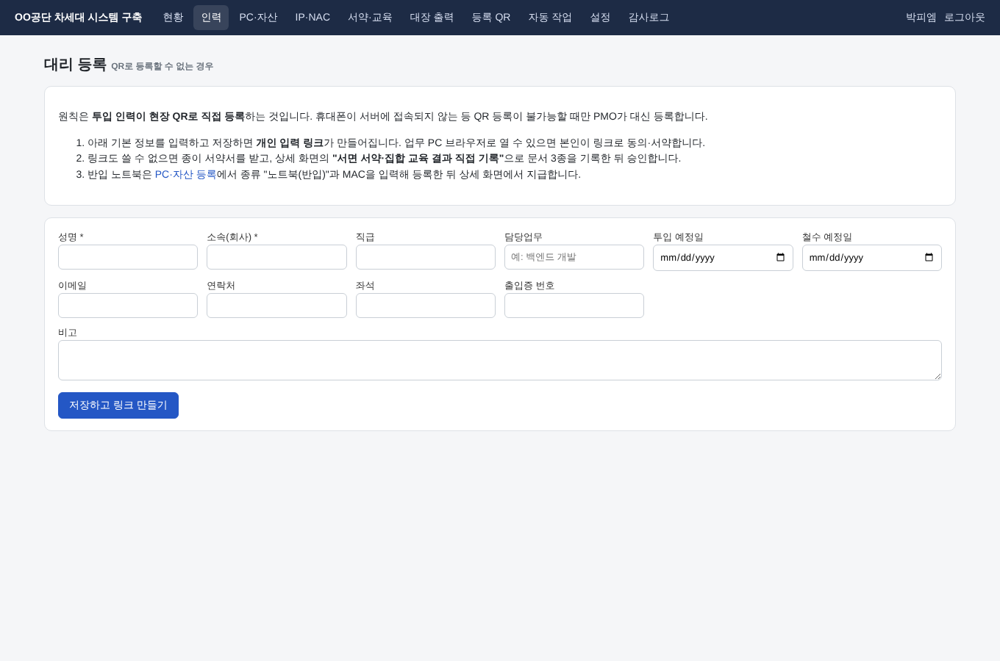

1. 기본 정보를 입력하고 저장하면 **개인 입력 링크**가 한 번 표시됩니다. 업무 PC 브라우저로 열 수 있으면 본인이 링크로 동의·서약합니다.
2. 링크도 쓸 수 없으면 종이 서약서를 받고, 인력 상세의 **"서면 서약·집합 교육 결과 직접 기록"**으로 개인정보 동의·보안서약·보안교육을 각각 기록합니다.
3. 반입 노트북은 자산 등록에서 종류 **"노트북(반입)"**과 MAC을 넣어 등록하고 인력 상세에서 지급합니다.
4. **투입 승인**을 누릅니다.

### 4.11 정기 교육·문서 개정

- 보안교육에 유효기간을 두면 **만료 30일 전부터 대시보드 알림**이 뜹니다.
- 본인 상태 화면(QR 재스캔)에 재이행할 교육이 자동으로 나타납니다. 상태 화면에 들어갈 수 없는 사람에게는 인력 상세에서 **"재서명·교육 링크 발급"**으로 새 링크를 줍니다. 단, **새 링크를 발급하면 그 사람 휴대폰에 기억된 이전 링크는 무효**가 되므로 새 링크로 접속하게 안내하세요.
- 집합 교육은 문서 상세에서 일괄 기록합니다(3.2).

### 4.12 개인정보 파기

철수 후 보관기간이 지나면 대시보드에 알림이 뜹니다. **인력 상세 → 개인정보 파기**를 누르면 연락처·이메일·생년월일·좌석·비고와 서명 IP가 영구 삭제됩니다. 성명·소속·투입 이력·서명 기록은 감사 증빙으로 남습니다.

---

## 5. 투입 인력 안내

> 이 장은 출력해서 투입 인력에게 나눠 주어도 됩니다.

### 5.1 첫 출근 날: QR로 등록하기

1. 현장에 붙은 **등록 QR**을 휴대폰 카메라로 찍습니다.
2. 본인 정보와 투입일·철수예정일을 입력합니다.
3. **업무에 사용할 PC**를 고릅니다.
   - 노트북을 가져왔다면 "반입"을 고르고 **유선 랜 MAC 주소**와 **시리얼 번호**를 입력합니다.
   - 현장에서 PC를 받을 예정이면 "지급 PC"를 고릅니다.
4. 개인정보 동의서·보안서약서·보안교육을 끝까지 읽고 각각 체크합니다.
5. 서명란에 **본인 성명**을 입력하고 "등록 제출"을 누릅니다.

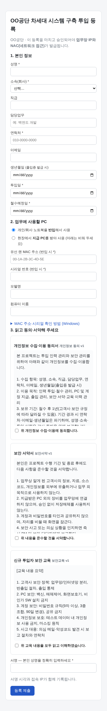

**MAC 주소·시리얼 확인 방법 (Windows)**

| 확인할 것 | 방법 |
|---|---|
| MAC 주소 | 시작 → `cmd` → `getmac /v` 입력 → 연결 이름이 **이더넷**(유선)인 줄의 "물리적 주소" |
| 시리얼 번호 | `wmic bios get serialnumber` 또는 노트북 바닥 스티커 |
| 컴퓨터 이름 | `hostname` |

> 무선(Wi-Fi) MAC이나 USB 랜 어댑터 MAC을 넣으면 NAC 인증이 되지 않습니다.

### 5.2 진행 상태와 IP 확인

제출하면 **내 상태 화면**이 열립니다. 이 화면을 즐겨찾기해 두세요. **같은 휴대폰으로 QR을 다시 찍어도 이 화면으로 옵니다.**

| 승인 대기 | NAC 처리 중 | 사용 가능 |
|---|---|---|
| 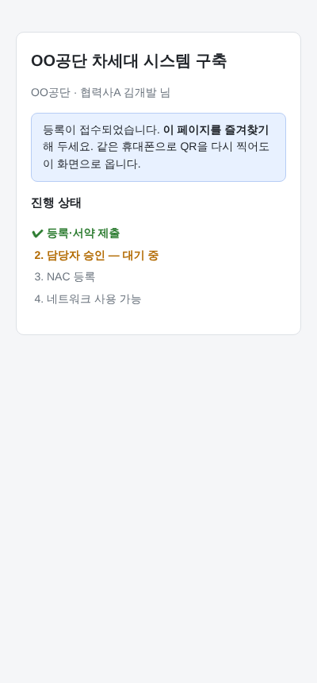 | 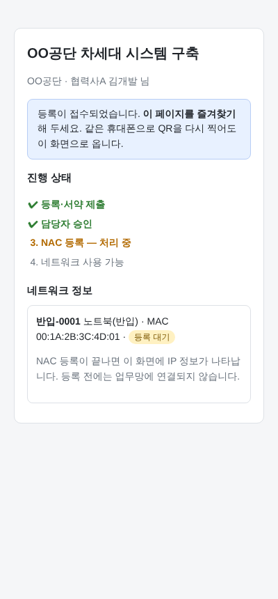 | 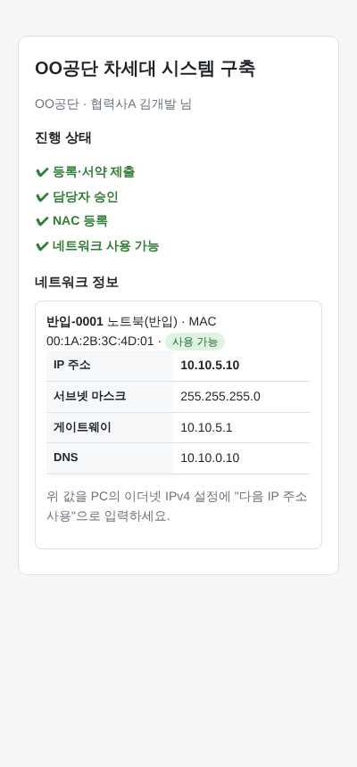 |

"사용 가능"이 되면 표시된 **IP 주소·서브넷 마스크·게이트웨이·DNS**를 PC의 이더넷 IPv4 설정에 "다음 IP 주소 사용"으로 입력합니다. **이 화면에 IP가 나오기 전에는 업무망에 연결되지 않습니다.**

### 5.3 철수할 때

철수가 시작되면 QR을 다시 찍어 상태 화면에서 **철수 보안 서약서**를 읽고 서명합니다. 지급받은 PC·출입증은 PMO에게 반납합니다.

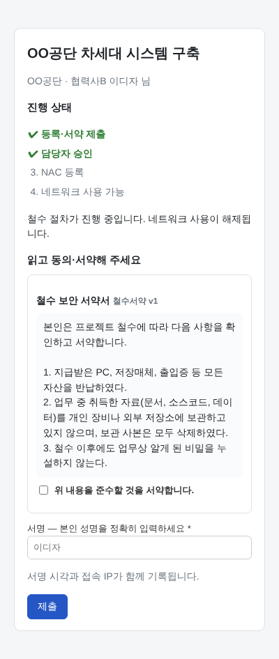

### 5.4 자주 묻는 질문

| 질문 | 답 |
|---|---|
| "QR 코드가 올바르지 않습니다"가 떠요 | 현장에 새로 붙은 QR을 찍으세요. 그래도 안 되면 PMO에게 문의하세요 |
| "이미 등록된 분입니다"가 떠요 | 처음 등록한 휴대폰으로 QR을 찍으세요. 휴대폰을 바꿨다면 PMO에게 링크 재발급을 요청하세요 |
| "MAC 주소는 … 이미 다른 장비에 등록"이 떠요 | MAC을 잘못 입력했는지 확인하세요. 맞다면 PMO에게 문의하세요 |
| 소속사가 목록에 없어요 | PMO에게 소속사 추가를 요청하세요 |
| IP를 넣었는데 연결이 안 돼요 | 상태가 "사용 가능"인지, 유선 랜 MAC을 등록했는지 확인하세요 |

---

## 6. 고객사 보안담당 안내 (조회전용 계정)

- PMO에게 받은 아이디와 임시 비밀번호로 로그인한 뒤 비밀번호를 바꿉니다.
- 현황, 인력, PC·자산, IP·NAC, 서약·교육 화면을 **조회만** 할 수 있습니다(등록·수정·승인 불가).
- **대장 출력**에서 대장 5종(HWP·CSV)과 제출 패키지를 직접 내려받을 수 있습니다.
- 인력 상세에서 개인별 **보안서약서**와 **철수확인서**를 내려받을 수 있습니다. 서약서에는 서명 일시, 서명 방식, 문서 버전과 본문 해시가 들어 있어 서명 당시 본문을 확인할 수 있습니다.

---

## 7. 관리

### 7.1 자동 작업

메뉴 **자동 작업**. 서버가 켜져 있으면 10분마다 확인해서 때가 된 작업을 실행합니다.

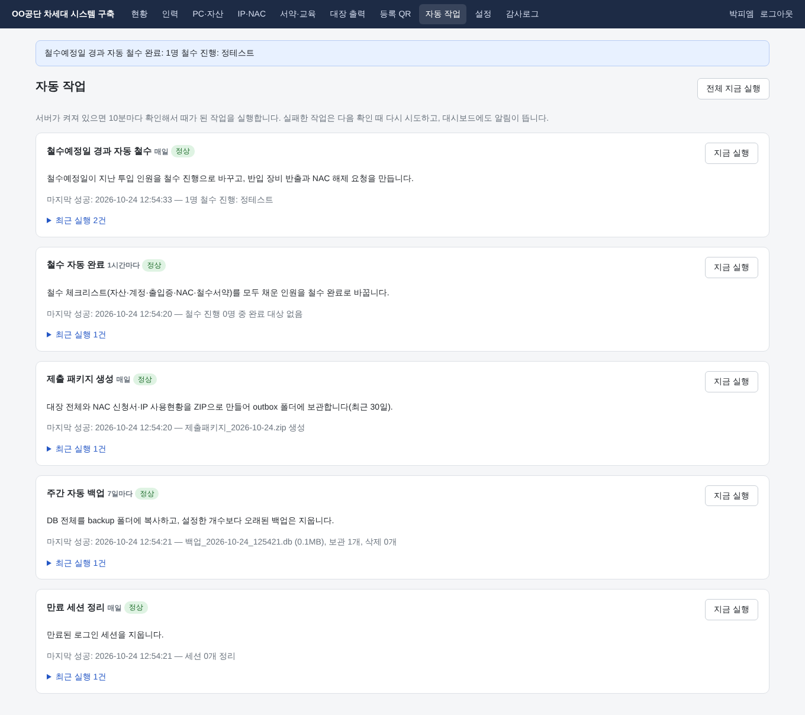

| 작업 | 주기 | 하는 일 |
|---|---|---|
| 철수예정일 경과 자동 철수 | 매일 | 철수 진행 전환, 반입 장비 반출, NAC 해제 요청 |
| 철수 자동 완료 | 1시간마다 | 체크리스트를 다 채운 인원을 철수 완료로 |
| 제출 패키지 생성 | 매일 | `데이터폴더\outbox`에 ZIP 생성, 30일 지난 것 삭제 |
| 주간 자동 백업 | 7일마다 | `데이터폴더\backup`에 DB 사본, 설정한 개수만 보관 |
| 만료 세션 정리 | 매일 | 만료된 로그인 정보 삭제 |

실패하면 배지가 "실패"로 바뀌고 대시보드에 알림이 뜹니다. "최근 실행"을 펼치면 원인 메시지가 보입니다. "지금 실행"으로 바로 다시 돌릴 수 있습니다.

### 7.2 백업과 복구

- **자동**: 주 1회 `backup` 폴더에 저장됩니다. 디스크 고장에 대비해 **승인된 반출 절차로 다른 저장소에도 복사**하세요.
- **수동**: 설정 → 백업 → "지금 백업 받기".
- **복구 순서**
  1. 서버(si-pms)를 끕니다.
  2. 데이터 폴더의 `pms.db`, `pms.db-wal`, `pms.db-shm`을 다른 곳으로 옮겨 둡니다.
  3. 복구할 백업 파일을 데이터 폴더에 `pms.db`라는 이름으로 복사합니다.
  4. 서버를 다시 켭니다.

### 7.3 감사 로그

메뉴 **감사로그**. 로그인, 등록, 승인, 지급, 출력, 파기, 설정 변경 등 모든 작업이 기록됩니다. "승인", "철수", "출력"처럼 한국어로 검색할 수 있습니다.

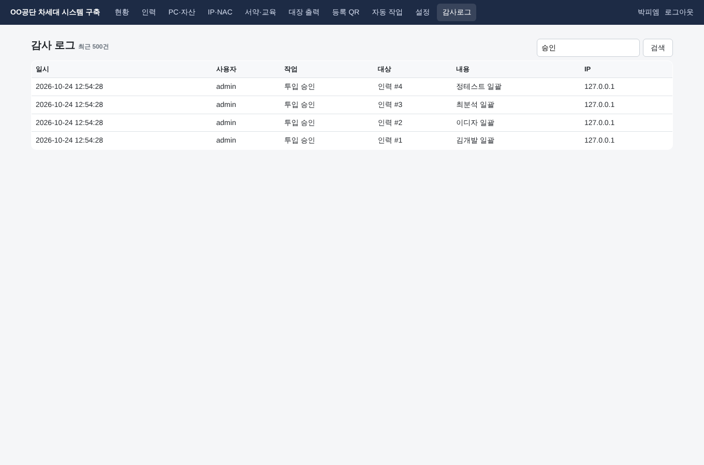

### 7.4 업그레이드

새 실행파일로 바꾸고 다시 시작하면 DB가 자동으로 업그레이드됩니다. 업그레이드 전에 반드시 백업을 받으세요.

---

## 8. 문제 해결

| 증상 | 원인과 해결 |
|---|---|
| **QR이 휴대폰에서 안 열려요** | 폐쇄망 서버는 LTE 휴대폰에서 접속되지 않습니다. ① NAC 등록 VLAN에서 이 서버만 허용하고 미등록 PC를 등록 페이지(`/join?c=...`)로 보내기(권장) ② 등록 전용 Wi-Fi ③ 입구에 등록용 태블릿/PC 비치 ④ 4.10 대리 등록 중 하나를 고르세요. 설정의 "접속 주소"가 해당 기기에서 열리는 주소인지도 확인하세요 |
| 일괄 승인 버튼이 없어요 | 점검을 통과한 사람이 없습니다. 승인 대기 목록의 ✘ 항목을 해결하세요 |
| "배정 가능한 IP가 없습니다" | 설정에서 IP 대역을 늘리거나, IP·NAC ③ 해제 대기를 완료 처리해 IP를 회수하세요 |
| 설정이 저장되지 않아요 | 화면 위 메시지의 항목이 잘못됐습니다. 고친 뒤 다시 저장하세요(전부 맞아야 저장됨) |
| 연장했는데 네트워크가 끊겼어요 | IP·NAC ② 만료일 변경 파일을 NAC에 반영하지 않았습니다 |
| 철수 완료가 안 돼요 | 철수 체크리스트의 ✘ 항목을 채우세요. NAC 해제 완료 처리를 빠뜨리는 경우가 많습니다 |
| 출력물에 `{{...}}`가 그대로 나와요 | 업로드한 양식의 자리표시자 이름이 틀렸습니다. 대장 출력 화면 아래 목록과 비교하세요 |
| 비밀번호를 잊었어요 | 다른 관리자가 설정 → 관리자 계정 → "비번 초기화". 관리자가 한 명뿐이면 아래 참고 |
| 서버 콘솔에 "경고: … 제약을 적용하지 못했습니다" | 기존 데이터에 같은 IP가 두 명에게 배정된 기록이 있습니다. IP·NAC 화면에서 해당 건을 해제 처리한 뒤 다시 시작하세요 |

> **관리자가 한 명뿐인데 비밀번호를 잊었다면**: 미리 **관리자 계정을 두 개**(예: PMO 본인, 예비 계정) 만들어 두는 것을 권합니다. 계정이 하나도 없으면 서버 시작 시 새 임시 비밀번호가 발급되지만, 기존 계정을 지우려면 DB를 직접 다뤄야 합니다.

---

## 9. 화면별 기능 목록

| 메뉴 | 기능 | 권한 |
|---|---|---|
| 현황 | 상태별 인원, NAC 대기, IP 사용량, 승인 대기열(자동 점검·일괄 승인), 할 일 알림, 30일 내 일정, 소속사별 인원 | 조회: 전체 / 승인: 관리자 |
| 인력 | 상태별 목록·검색, 대리 등록, 상세(기본 정보 수정, 승인·반려, 철수 시작·완료, 출입증 반납, 링크 발급, 서면 이행 기록, PC 지급·반납, 계정 발급·회수, IP·NAC 이력, 철수확인서·서약서 HWP, 개인정보 파기, 등록 삭제) | 조회: 전체 / 변경: 관리자 |
| PC·자산 | 목록·검색, 개별·CSV 일괄 등록, 수정, 지급·반납, 보안 점검 기록, 상태 변경(재고·수리·폐기), 이력 | 조회: 전체 / 변경: 관리자 |
| IP·NAC | 등록·만료일 변경·해제 대기, CSV·HWP 신청서, 완료 처리, 사용 중 IP 목록 | 조회: 전체 / 완료 처리: 관리자 |
| 서약·교육 | 문서 목록·추가·수정·버전 올리기, 이행 현황, 집합 교육 일괄 기록 | 조회: 전체 / 변경: 관리자 |
| 대장 출력 | 대장 5종 HWP·CSV, 제출 패키지, 고객사 양식 업로드·되돌리기, 자리표시자 안내 | 출력: 전체 / 양식 변경: 관리자 |
| 등록 QR | QR 포스터 인쇄, 등록코드 재발급 | 관리자 |
| 자동 작업 | 작업별 주기·결과·이력, 지금 실행 | 관리자 |
| 설정 | 프로젝트·QR·IP·NAC·자동화·자산 설정, 관리자 계정, 백업 | 관리자 |
| 감사로그 | 전체 작업 기록 검색 | 관리자 |
| 내 정보(이름 클릭) | 이름 변경, 비밀번호 변경 | 전체 |
| QR 등록 / 내 상태 화면 | 셀프 등록, 진행 상태, IP 확인, 재서명·철수서약 | 투입 인력(로그인 없음) |
